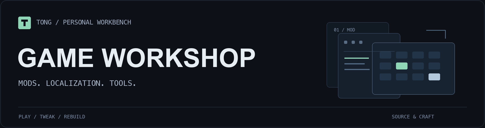

  

### 你好，我是 Tong。

做游戏 Mod，也做让游戏更好用的中文化与工具。把想玩的改动做出来，把构建、校验和恢复的过程留下来。

---

#### 01 / MODS　玩法改造

**[将军对决 · 秘传道场](https://github.com/zhu978985158-blip/shogun-hidendojo)** — 设置菜单、武器强化与商店刷新。  
**[小丑牌 · 规则实验室](https://github.com/zhu978985158-blip/balatro-rule-lab)** — 十二项独立规则开关与对局内设置。  
**[土豆兄弟 · AutoDodge](https://github.com/zhu978985158-blip/brotato-auto-dodge)** — 自动走位与可独立开关的成长辅助，基于 Full Auto Bot 修改。

#### 02 / LOCALIZATION　让游戏说中文

**[多游戏汉化与制作工具](https://github.com/zhu978985158-blip/game-localizations)**  
《天际特别版》《英灵神殿》、GTA SA、Battlevoid、Rambo、Worms、Art of War 2 与 Atrox 的译文、配置说明及制作资料。

#### 03 / TOOLING　修复与资源制作

**[星露谷物语 · macOS 头像修复](https://github.com/zhu978985158-blip/stardew-mac-portrait-fix)** — Portraiture 绘制与表情网格裁切修复源码。  
**[Hades · 立绘工具](https://github.com/zhu978985158-blip/hades-portrait-tools)** — 一代立绘的构建、像素校验与安装恢复。

更多工具与研究

- **[The Bazaar](https://github.com/zhu978985158-blip/the-bazaar-portrait-tools)** — 皮格马利翁 Unity / Spine 立绘与头像工具快照。
- **[雀魂](https://github.com/zhu978985158-blip/mahjong-soul-portrait-tools)** — 特定 Unity 立绘资源适配、像素校验与恢复工具。
- **[世界征服者4](https://github.com/zhu978985158-blip/wc4-1914-port)** — Android 1914 地图移植研究工具，部分完成。

---

适配版本、依赖、使用方法与验证范围，见各项目 README。
